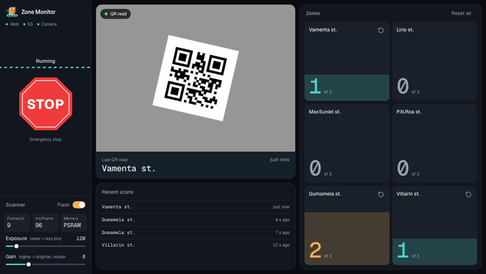
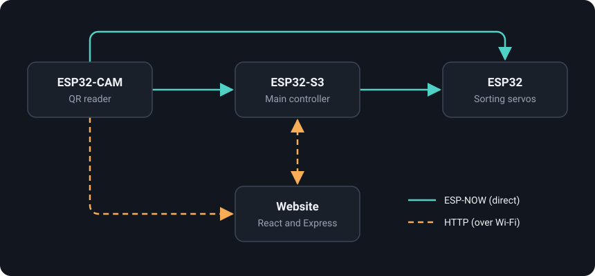
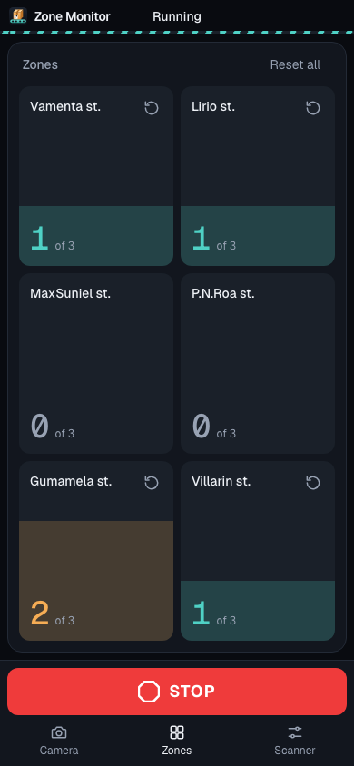

# Zone Monitor

A parcel-sorting conveyor built on three ESP32 boards and a live web dashboard. A camera reads the QR code on each parcel, the belt keeps moving while it scans, and the parcel is routed to its destination zone.



## How it works



| From | To | Link | Carries |
|---|---|---|---|
| Camera | S3 and servo board | ESP-NOW | The zone name from each QR code |
| Camera | S3 | ESP-NOW | "QR read" and "pause the belt" signals |
| S3 | Servo board | ESP-NOW | E-stop, resume and zone resets |
| S3 | Website | HTTP | Zone levels and QR text |
| Website | S3 | HTTP | E-stop and zone resets |
| Camera | Website | HTTP | Scanner status, and pictures while the page is open |
| Website | Camera | HTTP | Flash, exposure and gain |

- **Scanning:** the camera decodes QR codes without stopping the belt. If it can see a code but can't read it, it sharpens the picture and tries again, then asks the S3 to pause the belt for up to 3 seconds.
- **Zones:** each read adds to that zone's count, shown on the S3's screen and the website, up to a limit of 3.
- **Website:** shows the live camera picture, zone levels and recent scans, and controls E-stop, resets, flash, exposure and gain. Pictures are only uploaded while the page is open.



## Status

The firmware compiles for both boards and the S3's logic is tested on a computer with fake hardware. The website is tested against simulated boards. **None of this has yet been run on the real hardware**, so speed on the boards is unmeasured.

The servo board's firmware is not in this repository. It needs to accept these 32-byte ESP-NOW messages: a zone name, `ESTOP`, `RESUME`, `RESET:<n>` and `RESET_ALL`.

> [!WARNING]
> The on-screen STOP button is not a safety device. It depends on Wi-Fi and the server, and if the website goes down the belt keeps running. Fit a physical emergency stop that cuts the motor's power directly.

## Hardware

| Board | Role | Connected to |
|---|---|---|
| ESP32-S3 | Main controller | BTS7960 motor driver, ILI9341 screen, WS2812B LED strip, buzzer |
| AI Thinker ESP32-CAM | QR reader | Built-in OV2640 camera and flash |
| ESP32 | Sorting | Servos, one for each zone |

Pins are set in `zone_monitor/config.h` and `zone_cam/cam_config.h`.

## Repository layout

| Folder | Contents |
|---|---|
| `zone_monitor/` | ESP32-S3 firmware, mostly C |
| `zone_cam/` | ESP32-CAM firmware, with the [quirc](https://github.com/dlbeer/quirc) QR decoder |
| `web/` | Website: React, strict TypeScript, Tailwind CSS and an Express API |
| `tests/s3_host/` | S3 logic tests that run on a computer |
| `tools/` | Editor setup for the firmware |

## Getting started

### 1. Settings

Copy the example settings, then fill in your Wi-Fi details, the website's address, a device key and the boards' MAC addresses. Git ignores the copies.

```sh
cp zone_monitor/secrets.example.h zone_monitor/secrets.h
cp zone_cam/secrets.example.h zone_cam/secrets.h
cp web/.env.example web/.env
```

Use the same `DEVICE_KEY` in all three files.

### 2. Website

Needs Node.js 22.18 or newer.

```sh
cd web
npm install
npm run build
npm start
```

To try it with no hardware, run `npm run simulate` in a second terminal. See [web/README.md](web/README.md) for the API.

### 3. Firmware

Needs [arduino-cli](https://arduino.github.io/arduino-cli/) with the `esp32` board package, version 3.3 or newer.

```sh
arduino-cli lib install FastLED "Adafruit GFX Library" "Adafruit ILI9341"

arduino-cli compile --fqbn esp32:esp32:esp32s3 zone_monitor
arduino-cli upload  --fqbn esp32:esp32:esp32s3 --port <port> zone_monitor

arduino-cli compile --fqbn esp32:esp32:esp32cam zone_cam
arduino-cli upload  --fqbn esp32:esp32:esp32cam --port <port> zone_cam
```

Zone names appear in `zone_monitor/zones.c` and `web/src/shared/types.ts`. Keep them the same, and print them as the QR code text.

## Tests

```sh
tests/s3_host/run.sh     # S3 logic, with memory and undefined-behaviour checks
cd web && npm test       # API
cd web && npm run typecheck
```

## Security

The dashboard has no login, so anyone on the same network can use its controls, including resuming the belt. Run it on a private network only.

## License

Licensed under the [Apache License 2.0](LICENSE). The quirc decoder in `zone_cam/` keeps its own ISC license: see [quirc_LICENSE.txt](zone_cam/quirc_LICENSE.txt).
